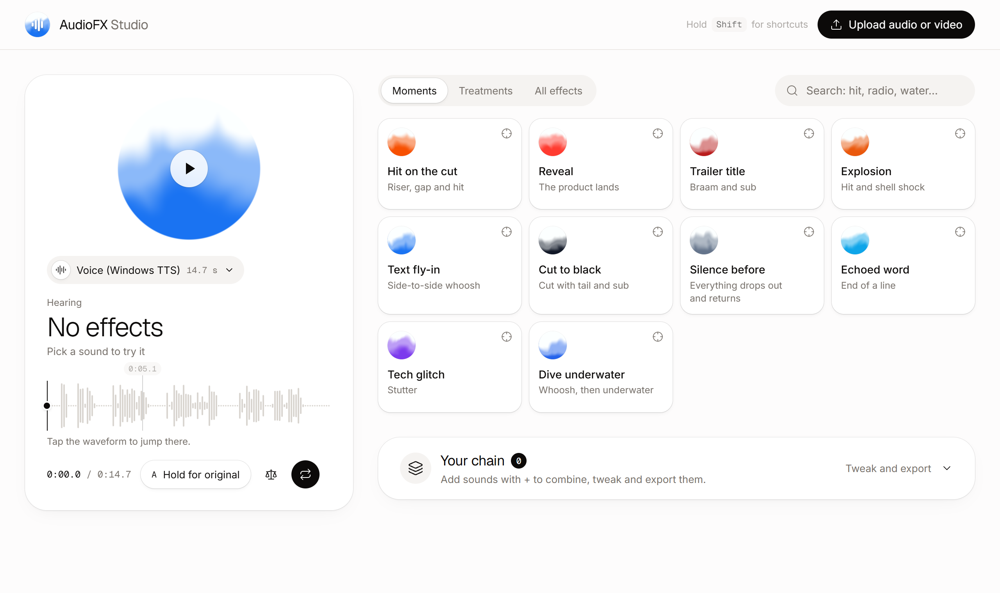

<div align="center">


# AudioFX

**Sound design for video, as plain ffmpeg filtergraphs.**
Underwater, old radio, phone calls, trailer hits, risers, whooshes and 61 more effects,
built so coding agents (and people) can use them when they put a video together.

</div>



## Why

- **One string, any pipeline.** Every effect compiles to a filtergraph you pass straight to `ffmpeg -af`. It works from the CLI, Python, Remotion or your own render script, and what you hear in the studio is exactly what renders.
- **Made for moments.** Cinema elements (hit, riser, whoosh, sub drop, braam, a gap before the drop, a cut with a tail) are synthesized and land on the exact second you mark. No licensed samples.
- **Agents know when to use what.** Each effect ships with a description and "when to use it", and two skills teach Claude Code and Codex how to pick, chain and mix them.
- **ElevenLabs built in.** Generate a sound effect, a voice or a song from a prompt and run it through any effect in one step.

## Quick start

You need Node 20+, pnpm and ffmpeg 7 (the [gyan.dev](https://www.gyan.dev/ffmpeg/builds/) builds on Windows, `brew install ffmpeg` on macOS).

```bash
git clone https://github.com/NachoEstevo/audiofx.git
cd audiofx
pnpm install
pnpm studio
```

The studio opens at `http://127.0.0.1:5177`. Pick an audio, tap a sound to hear it on your audio, hold `A` to compare with the original, and add the ones you like to your chain to tweak and export them.

`node bin/sfx.mjs doctor` checks ffmpeg and the filters the catalog needs.

## CLI

```bash
sfx apply voice.wav call.wav telephone
sfx apply clip.mp4 clip-fx.mp4 "underwater:depth=0.8@3.2-7" loudness
sfx apply mix.wav mix-hit.wav "riser:at=6" "drop-gap:at=5.55" "hit:at=6"
sfx graph "reverb:space=cathedral,mix=0.4"     # just the filtergraph
sfx list                                       # the catalog
sfx describe am-radio                          # params and when to use it
```

A step is `effect[:param=value,...][@from-to]`. Steps run in order, `@from-to` limits an effect to a window, and video outputs keep the picture untouched. Run `pnpm link --global` to get `sfx` on your PATH, or call `node bin/sfx.mjs`. The full catalog is in [CATALOG.md](CATALOG.md).

## ElevenLabs

Add an ElevenLabs API key and generate the raw material right where you process it:

```bash
sfx generate voice "Hey, it's me. Open the door." call.wav voice-clean telephone
sfx generate music "Upbeat indie pop, 120 bpm" song.wav "underwater@12-18" --duration 30 --instrumental
sfx generate sfx "Heavy wooden door slams in a stone hallway" door.wav "reverb:space=hall,mix=0.25"
```

To connect, run `npx -y @elevenlabs/cli@latest onboard init` (it writes a `.env`) or put `ELEVENLABS_API_KEY=...` in `~/.audiofx/.env`. The key stays on your machine. Generations are kept in `~/.audiofx/generated` so you can reuse them, and the studio has a *Generate* tab that does the same.

## Skills for agents

```bash
pnpm skill:install
```

This installs two skills into `~/.claude/skills` and `~/.codex/skills`:

- **sound-design**: which effect fits each scene, chain order, sync and tail rules, recipes for Python, Remotion and ducking.
- **elevenlabs-fx**: connecting to ElevenLabs (API key, hosted MCP, official skills), prompting sound effects, and recipes that combine generation with effects.

## Your audio library

The studio lists the audio in `~/Music` and `~/Downloads`. To use other folders, create `~/.audiofx/library.json`:

```json
{ "folders": ["C:/Users/you/Videos/media", "D:/Projects/sounds"] }
```

## Development

```bash
pnpm test        # effects render without NaN, keep sync, hit their frequency targets
pnpm typecheck
pnpm catalog     # regenerate CATALOG.md from src/core/effects
```

How it is built (filtergraph compilation, gain staging, the WebGL orbs) is in [docs/DESIGN.md](docs/DESIGN.md).

## Credits

- Waveform and scrubber adapted from [ElevenLabs UI](https://github.com/elevenlabs/ui) (MIT). The studio takes ElevenLabs' product style as a visual reference without using their brand.
- The fluid orbs and the logo are adapted from [Rare UI](https://rareui.com)'s FluidOrb (MIT + Commons Clause + attribution).
- Motion and interaction details inspired by [transitions.dev](https://transitions.dev/) and [detail.design](https://detail.design/).

## License

[MIT](LICENSE). Third-party components keep their own licenses, noted in the file headers and in the LICENSE file.
